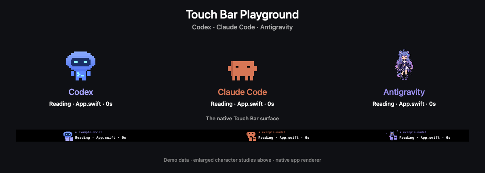

# Touch Bar Playground

Animated AI coding companions for the MacBook Pro Touch Bar. Codex, Claude Code
and Antigravity share the free space, act out their current work, and stay awake
while their apps are open.



*[Still preview](docs/images/companions-preview.png). The loop uses demo data
rendered by the app's real AppKit drawing code. Enlarged character studies are
shown above the native Touch Bar surface.*

## What you get

- **Three companions:** Codex's blue humanoid, a copper Clawd adaptation, and the
  purple-haired Gemini-chan community character for Antigravity.
- **Live context:** reported model IDs, current actions and elapsed action time
  when a start is available. Multiple sessions rotate through their model IDs.
- **A shared playground:** busy companions get more room; open but idle apps
  keep their companions awake and strolling. Closed, inactive tools sleep.
- **Action reactions:** reading, searching, editing, commands, tests, builds,
  thinking and screen checks, plus attention and completion reactions.
- **Honest recaps:** confirmed file changes, a reported test-command exit result
  and turn duration when available. Missing metadata is shown as unavailable.
- **Local operation:** no API keys, network service or runtime package downloads.

## Clone and install

Requirements: **Apple Silicon Mac, macOS 13+, Xcode's Swift/Clang toolchain, and
Python 3**. A built-in Touch Bar is needed for hardware output. The desktop
preview can be used without one. Intel builds have not been validated.

```sh
git clone https://github.com/RaymanMoha/touchbar-playground.git
cd touchbar-playground
./install.sh
```

The installer builds from source, ad-hoc signs the app, installs it to
`~/Applications/Touch Bar Playground.app`, adds observational Claude Code and
Antigravity hooks, and opens the controls. Existing settings are preserved with
timestamped backups. Restart existing tool sessions to load new hooks.

If you want to build and inspect it before connecting your tools:

```sh
./build.sh
open "Touch Bar Playground.app"
```

That opens the app and reads local Codex activity. It does not install Claude or
Antigravity hooks; those are added by `install.sh`.

## Use it

The blue companion in the menu bar opens the controls.

| Control | Behaviour |
| --- | --- |
| **Live activity** | Follows local tool activity and reported models. |
| **Try animations** | Cycles through demo work, attention, completion, idle and sleep. |
| State menus | Preview individual companion reactions. |
| **Show on Touch Bar / Hide** | Show the playground or restore normal app controls. |
| Tap a companion | Bring its coding app forward. |
| Tap empty space | Call the nearest companion over. |

Choose **Live activity** after experimenting with preview states. The app does
not start automatically at login. Quit it from its menu bar menu.

Physical Esc and Apple's Control Strip are retained on the tested hardware.
For terminal Claude Code, tapping the character opens the Claude desktop app;
it does not select a particular terminal session.

## How the connections work

| Tool | Source | Limits |
| --- | --- | --- |
| Codex | Incremental local session events and per-turn model metadata. | Internal log formats can change. Attention events are best effort. |
| Claude Code | Before/after-tool, permission, notification and session hooks. Model IDs come from hook metadata or current-turn response metadata. | Restart existing sessions for new hooks. |
| Antigravity | `PreInvocation`, `PostToolUse` and `Stop` hooks. | Post-tool captions are completed actions; no invented start clock. A reliable permission-wait signal is not exposed by this integration. |

The Codex reader checks recently modified sessions from today and yesterday,
reading at most the newest 8 MiB per file at startup. Records expire after eight
hours. A very long turn whose model context is outside that window can show an
unknown model until fresh metadata arrives. **Auto (reported)** means the tool
reported Auto; the underlying routed model is not guessed.

Only normalized activity, model, session and recap metadata is stored in
`~/Library/Application Support/TouchBarPlayground/events`. Captions may contain
file basenames. Raw prompts, responses, command text, tool output and full file
paths are not persisted there. Existing Codex `notify` settings are unchanged.
Hooks never approve tools, rewrite arguments, inject context or force the agent
to continue.

## Disconnect

```sh
python3 scripts/connect-tools.py --remove
```

This removes this utility's hooks while preserving other settings. Then quit the
app and remove it from `~/Applications` if you no longer want it.

## Reproduce the animated example

```sh
./scripts/render-demo.sh
```

This exports `docs/images/companions-demo.gif` and a PNG poster using AppKit and
ImageIO. It needs the same Apple Silicon/Xcode toolchain as the app, with no
additional packages. It does not connect hooks or read live tool activity.

The roughly twelve-second loop shows:

1. Reading with all three companions working.
2. Testing while Claude asks for attention.
3. A demo completion recap and celebration.
4. Open apps staying awake and idle.

Model names, filenames, test marks and recap counts in this gallery are example
data. The small black strip is the real native playground renderer; the larger
figures make the character designs easier to inspect.

## Verify a build

```sh
./build.sh
python3 scripts/verify-hooks.py
```

The build runs the core checks. Hook verification uses a temporary state folder;
it does not change your tool settings or real activity records. See
[verification notes](docs/VERIFICATION.md) for what was checked and what remains
unconfirmed.

## Compatibility

Keeping a Touch Bar visible while switching apps uses dynamically checked
**private AppKit system-modal Touch Bar methods**, isolated in
`Sources/TouchBarBridge.m`. Apple may change them. The desktop preview remains
available if hardware presentation is unsupported. This is a local utility,
not an App Store release.

The hardware surface is 685 × 30 points, tested on an M2 MacBook Pro. Expanding
the Control Strip or pressing Fn may temporarily replace it. Use **Show on Touch
Bar** to restore it. Avoid running two Touch Bar replacement utilities together.

## License and credits

Project code is [MIT licensed](LICENSE). Third-party artwork and brand references
are credited in [THIRD_PARTY_NOTICES.md](THIRD_PARTY_NOTICES.md).
Gemini-chan's original atlas, manifest and source license are included in
`Assets/`. She is a community character, not a verified official Google mascot.
This project is independent of OpenAI, Anthropic and Google.
